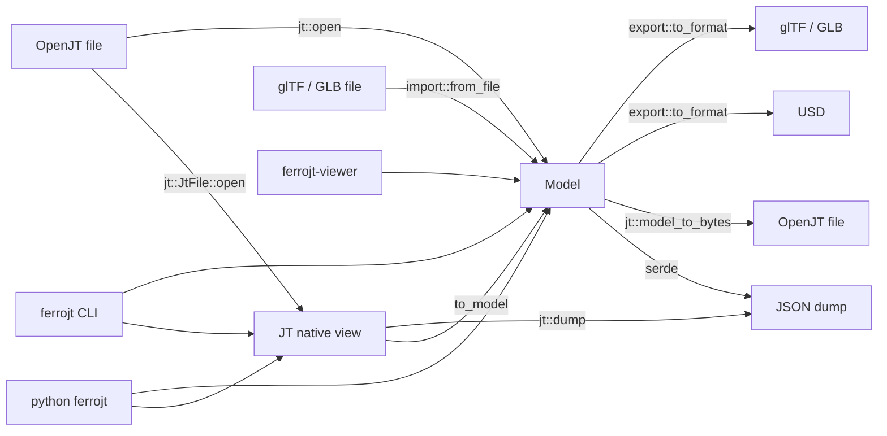

# Architecture

Everything flows through one neutral structure, [`Model`](../crates/ferrojt/src/model/scene.rs).
Readers produce it, writers consume it, and the CLI, the Python bindings and the
viewer are thin consumers: the viewer turns the `Model` straight into GPU meshes
rather than going through a file format, so it shows what the reader decoded.

JT is read twice over. `jt::JtFile` keeps the format's own shape — header, TOC
table and a handle based `SceneGraph` — because `ferrojt dump` and
`ferrojt.JtFile` have to reproduce the JT tooling byte for byte, which the
neutral model cannot. `JtFile::to_model()` then flattens that view into a
`Model` for the exporters, and in doing so keeps only the finest level of
detail of every range LOD: a glTF or USD file gets one mesh per part rather
than one per tier. See [jt-reader.md](jt-reader.md).

JT is written three ways, and only one of them is an exporter. `jt::write`
re-serialises a file it has read, `jt::build` assembles one from nothing, and
`jt::from_model` writes a neutral `Model` by handing it to the builder — which
is how a glTF file becomes a `.jt` one. See [jt-writer.md](jt-writer.md),
[jt-builder.md](jt-builder.md) and [jt-from-model.md](jt-from-model.md).

## The neutral model

| Type | File | Role |
| --- | --- | --- |
| `Model` | `model/scene.rs` | Owns every table: `nodes`, `scenes`, `meshes`, `materials`, `textures`, `accessors`, plus `unit`, `up_axis`, `bounds`. |
| `Node` / `Transform` / `Instance` | `model/scene.rs` | Scene graph. `Transform` stores JT's right handed, CCW, `x y z w` quaternion convention. |
| `Mesh` / `Primitive` | `model/geometry.rs` | Geometry. A primitive lists attribute *handles* (`Vec<usize>`), an optional index handle, a `Topology` and an optional material index. |
| `Attribute` / `BufferBlock` | `model/geometry.rs` | `Attribute` is a typed view — `(buffer, offset, count, components, component_type, normalized)` — into an opaque `BufferBlock`. |
| `Accessors` | `model/geometry.rs` | The two tables above plus `push_buffer` / `push_attribute` / `attribute` / `attribute_bytes`. |
| `Material` / `Channel` / `Texture` | `model/material.rs` | A small metallic/roughness model that maps cleanly onto both glTF and USD. |
| `Aabb` | `model/bounds.rs` | Axis aligned bounds. |

Design rules:

* All cross references are `usize` indices into the owning `Vec` on `Model`. No
  `Rc`, no lifetimes, no cycles — the graph is `Clone + Serialize` and can be
  walked with `rayon`.
* Vertex data is never restructured on read. A reader appends bytes to a
  `BufferBlock` and describes them with an `Attribute`; exporters reinterpret or
  widen on demand.
* `crates/ferrojt` is `#![forbid(unsafe_code)]` and has no `unsafe` blocks.

## Codecs

`codec/` holds the primitives a JT reader needs, independent of the format:

* `endian` — `ByteOrder` plus `ReaderExt` / `WriterExt` on `std::io::Read` /
  `Write`. JT stores metadata big endian and vertex data in either order, so the
  order is always an explicit argument.
* `bits` — an MSB first `BitReader` for the packed JT header fields.
* `compress` — zlib and XZ signature checks plus `inflate`, `deflate` and
  `decompress_xz`. JT 10.x concatenates several XZ streams per segment, so
  `find_xz_streams` splits them before decoding.

## The JT reader

`jt/` is the format layer, and it is deliberately separate from `model/`:

* `jt::segment` — header banner, TOC table, segment framing, compression
  envelopes.
* `jt::reader` — the endian aware cursor every element reader uses.
* `jt::object` — LSG nodes, attributes and element objects.
* `jt::decode` — Huffman, the range/CDP driver, the vertex coders and the mesh
  coder, verified byte for byte against the reference output.
* `jt::model` — `JtFile` and `SceneGraph`, plus `to_model()` and the layer
  filter that decides which parts an export keeps. It declares `millimeter` /
  `+Z` on the model it builds.
* `jt::dump` — the JSON layout the JT tooling writes, including the C `%g`
  number formatting that `format_g` reproduces.
* `jt::write` — re-serialises a file that was read, copying every segment but
  the scene graph out of the source. See [jt-writer.md](jt-writer.md).
* `jt::build` — assembles a file from nothing, JT 10.3 by default. See
  [jt-builder.md](jt-builder.md).
* `jt::from_model` — writes a neutral `Model` through the builder, choosing the
  revision the meshes of the model can be coded at. See
  [jt-from-model.md](jt-from-model.md).

See [jt-reader.md](jt-reader.md) and [usd-writer.md](usd-writer.md) for the two
contracts that bound the workspace.

## Readers besides JT

`import/` holds the readers that are not the JT one, and they are peers of
`jt/`, not a layer under it:

* `import::gltf` — `.gltf` and `.glb` in, `Model` out. Vertex data is kept
  exactly as authored (one buffer block per glTF buffer, one attribute per
  accessor), images are stored encoded rather than decoded, and a node matrix is
  decomposed because JT and USD store translation, rotation and scale. It
  declares `meter` / `+Y` on the model, because glTF 2.0 is metric and Y up by
  contract. See [gltf-reader.md](gltf-reader.md).

`crate::open` / `open_format` dispatch on `Format`, and `Format::is_readable`
says what can be read. The CLI and the Python bindings call only those.

## Exporters

`export/mod.rs` defines `Exporter { FORMAT, write }` and the dispatchers
`to_format` and `write_to_file`.

* `export/gltf.rs` builds a `gltf_json::Root` directly (no `gltf` dependency in
  the library) and merges every buffer into one BIN buffer. `.gltf` output inlines
  that buffer as a base64 data URI.
* `export/glb.rs` does the GLB framing that `gltf-json` does not provide: header,
  JSON chunk padded with `0x20`, BIN chunk padded with `0x00`. A chunk's declared
  length is the **padded** length, not the payload length.
* `export/usd.rs` writes an ASCII `.usda` layer by hand: every mesh is authored
  once in an invisible geometry library and referenced by its consumers, and
  materials are collapsed by shading value. See [usd-writer.md](usd-writer.md).
* `Format::Jt` is writable but deliberately bypasses the `Exporter` trait: the
  trait has no place for the revision to write at, so `to_format` special-cases
  it into `jt::model_to_bytes`. See [jt-from-model.md](jt-from-model.md).

## Error handling

`error::Error` distinguishes `Io`, `Json`, `UnsupportedFormat`, `Unsupported`,
`NotImplemented`, `Invalid { offset, message }` and `Corrupt`. The CLI maps
`NotImplemented` to a friendly message, and the Python bindings map it to
`NotImplementedError`.
