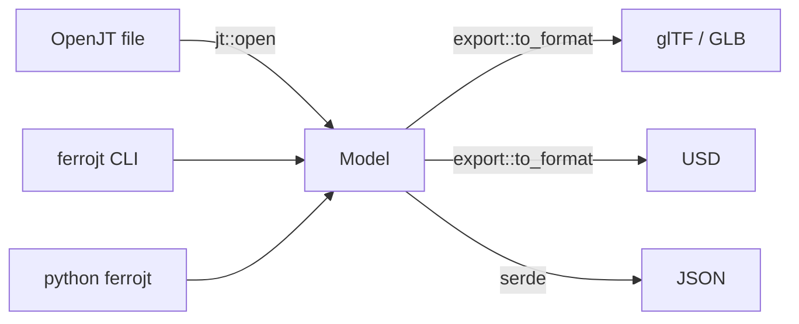

# Architecture

Everything flows through one neutral structure, [`Model`](../crates/ferrojt/src/model/scene.rs).
Readers produce it, writers consume it, and the CLI and Python bindings are thin
wrappers over `ferrojt::open` plus `ferrojt::export::*`.

## The neutral model

| Type | File | Role |
| --- | --- | --- |
| `Model` | `model/scene.rs` | Owns every table: `nodes`, `scenes`, `meshes`, `materials`, `textures`, `accessors`, plus `unit`, `up_axis`, `bounds`. |
| `Node` / `Transform` / `Instance` | `model/scene.rs` | Scene graph. `Transform` stores JT's right handed, CCW, `x y z w` quaternion convention. |
| `Mesh` / `Primitive` | `model/geometry.rs` | Geometry. A primitive lists attribute *handles* (`Vec<usize>`), an optional index handle, a `Topology` and an optional material index. |
| `Attribute` / `BufferBlock` | `model/geometry.rs` | `Attribute` is a typed view — `(buffer, offset, count, components, component_type, normalized)` — into an opaque `BufferBlock`. |
| `Accessors` | `model/geometry.rs` | The two tables above plus `push_buffer` / `push_attribute` / `attribute` / `attribute_bytes`. |
| `Material` / `Channel` / `Texture` | `model/material.rs` | A small metallic/roughness model that maps cleanly onto both glTF and USD. |
| `Aabb` | `model/bounds.rs` | Axis aligned bounds. |

Design rules:

* All cross references are `usize` indices into the owning `Vec` on `Model`. No
  `Rc`, no lifetimes, no cycles — the graph is `Clone + Serialize` and can be
  walked with `rayon`.
* Vertex data is never restructured on read. A reader appends bytes to a
  `BufferBlock` and describes them with an `Attribute`; exporters reinterpret or
  widen on demand.
* `crates/ferrojt` is `#![forbid(unsafe_code)]` and has no `unsafe` blocks.

## Codecs

`codec/` holds the primitives a JT reader needs, independent of the format:

* `endian` — `ByteOrder` plus `ReaderExt` / `WriterExt` on `std::io::Read` /
  `Write`. JT stores metadata big endian and vertex data in either order, so the
  order is always an explicit argument.
* `bits` — an MSB first `BitReader` for the packed JT header fields.
* `compress` — zlib signature check, `inflate` and `deflate`.

## Exporters

`export/mod.rs` defines `Exporter { FORMAT, write }` and the dispatchers
`to_format` and `write_to_file`.

* `export/gltf.rs` builds a `gltf_json::Root` directly (no `gltf` dependency in
  the library) and merges every buffer into one BIN buffer. `.gltf` output inlines
  that buffer as a base64 data URI.
* `export/glb.rs` does the GLB framing that `gltf-json` does not provide: header,
  JSON chunk padded with `0x20`, BIN chunk padded with `0x00`.
* `export/usd.rs` is a documented stub; see [usd-writer.md](usd-writer.md).

## Error handling

`error::Error` distinguishes `Io`, `Json`, `UnsupportedFormat`, `Unsupported`,
`NotImplemented`, `Invalid { offset, message }` and `Corrupt`. The CLI maps
`NotImplemented` to a friendly message, and the Python bindings map it to
`NotImplementedError`.
